 

 

  

---

## 👨‍💻 About Me

Hi! I'm **Sai Lokesh Nalabothu**, a Computer Science Engineering student specializing in Cyber Security.

I'm passionate about building modern software applications, designing scalable backend systems, exploring artificial intelligence, and developing secure digital experiences.

- 🎓 B.Tech in Computer Science Engineering — Cyber Security
- 💻 Interested in full-stack and backend engineering
- 🤖 Exploring AI engineering, RAG, embeddings, and LLM applications
- 🔐 Learning application security and secure system design
- 🗄️ Interested in database engineering and performance optimization
- ⚙️ Building REST APIs, authentication systems, and developer tools
- ☁️ Exploring cloud infrastructure, DevOps, and distributed systems
- 🌱 Continuously learning, experimenting, and building real-world projects

 

---

## 🧭 Technical Focus

| Domain | Technologies and Concepts |
|:--|:--|
| 🌐 Full-Stack Development | React, Node.js, Express.js, TypeScript, REST APIs |
| 🗄️ Database Engineering | MongoDB, PostgreSQL, MySQL, Redis |
| 🤖 AI Engineering | LLMs, RAG, embeddings, vector search, AI APIs |
| 🔐 Cybersecurity | JWT, OAuth 2.0, RBAC, authentication, API security |
| ☁️ Cloud and DevOps | Docker, Git, GitHub Actions, CI/CD, AWS fundamentals |
| 📱 Mobile Development | Android, Kotlin, Jetpack Compose, Firebase |
| 🧪 Testing and Quality | API testing, integration testing, automated testing |
| 🏗️ System Design | API architecture, caching, scalability, data modeling |

---

## 🚀 Featured Projects

### 🧠 DevPrep AI — AI-Powered Interview Platform

An interview preparation platform designed to combine coding practice, mock interviews, and AI-assisted feedback in one developer-focused experience.

**Key features**

- 💬 Real-time communication using WebSockets
- 💻 Code execution integration using Judge0
- 🤖 AI-assisted interview experiences
- 📊 Interview performance and progress analytics
- ⚙️ REST APIs and database integration
- 🔄 Redis integration for real-time system coordination

**Tech stack:** Node.js · MongoDB · WebSockets · Redis · REST APIs · Gemini API · Judge0

---

### 🔐 AuthX — Authentication and Authorization

A full-stack authentication system focused on secure identity management, access control, and account protection.

**Key features**

- 🔑 JWT-based authentication architecture
- 🛡️ Role-based access control (RBAC)
- 🔒 Account lockout and rate limiting
- 🔗 Google OAuth 2.0 integration
- ✉️ OTP registration and password recovery
- 🔄 Client-side authentication interceptors

**Tech stack:** React · Node.js · Express.js · MongoDB · JWT · OAuth 2.0

---

### 📱 ScrollOrStudy — Android Productivity App

An Android productivity application designed to help users understand distracting phone usage and develop better digital habits.

**Key features**

- 📈 App usage tracking and productivity insights
- 🔐 Biometric authentication
- ☁️ Firebase integration
- 💾 Local usage counters with DataStore
- 📱 Native Android interface using Jetpack Compose

**Tech stack:** Kotlin · Jetpack Compose · Firebase · DataStore · Android APIs

---

## 🛠️ Languages and Technologies

### Programming Languages

### Frontend and UI Development

### Backend and Databases

### Cloud, DevOps and Developer Tools

---

## 📊 GitHub Statistics

  

---

## 🐍 Contribution Snake

<picture>
  <source
    media="(prefers-color-scheme: dark)"
    srcset="https://raw.githubusercontent.com/SailokeshNalabothu/SailokeshNalabothu/output/github-contribution-grid-snake-dark.svg"
  />
  <source
    media="(prefers-color-scheme: light)"
    srcset="https://raw.githubusercontent.com/SailokeshNalabothu/SailokeshNalabothu/output/github-contribution-grid-snake.svg"
  />
  
</picture>

---

## 🎯 Goals and Continuous Learning

- [ ] Build production-quality full-stack applications
- [ ] Develop practical RAG and LLM-powered applications
- [ ] Improve system design and database optimization
- [ ] Strengthen cybersecurity and secure coding skills
- [ ] Contribute to open-source projects
- [ ] Improve problem-solving and technical interview skills
- [ ] Learn more about cloud architecture and DevOps
- [ ] Write clean, maintainable, and well-tested code

---

## 🤝 Connect With Me

  

---

### 💡 Build with purpose. Secure by design. Improve every day.

