 

<!-- replace with your real email -->

 

  

---

## 👋 About Me

I'm a Computer Science student specializing in **Cyber Security**. I enjoy the parts of software users never see: authentication, API design, data modeling, and real-time systems. I try to build them so they are secure by default and easy to maintain.

<table align="center">
  <tr>
    <td align="center" width="33%">
      <h3>🏗️ Build</h3>
      Full-stack apps with clean REST APIs, solid data models, and real-time features.
    </td>
    <td align="center" width="33%">
      <h3>🔐 Secure</h3>
      JWT, OAuth 2.0, RBAC, rate limiting, and account protection from day one.
    </td>
    <td align="center" width="33%">
      <h3>🤖 Explore</h3>
      LLM-powered features, RAG pipelines, and AI-assisted developer tools.
    </td>
  </tr>
</table>

**🔭 Currently:** building **DevPrep AI**, and learning RAG pipelines, PostgreSQL, and system design.  
**🎯 Open to:** internships and entry-level roles in full-stack or backend engineering.

---

## 🚀 Featured Projects

### 🧠 DevPrep AI — Interview Preparation Platform

A developer-focused platform that combines coding practice, mock interviews, and AI-generated feedback in one place.

- Real-time sessions over **WebSockets**, with **Redis** for coordination
- Code execution through the **Judge0** API
- AI-assisted interview feedback using the **Gemini API**
- Progress tracking and performance analytics backed by **MongoDB**

---

### 🔐 AuthX — Authentication and Authorization System

A full-stack identity and access management project built around common real-world security requirements.

- **JWT**-based authentication with **role-based access control (RBAC)**
- **Account lockout** and **rate limiting** to slow down brute-force attempts
- **Google OAuth 2.0** sign-in
- **OTP** verification for registration and password recovery
- Client-side interceptors to handle authenticated requests

<!-- add your repo link, or swap this block for a pin card:
 -->

---

### 📱 ScrollOrStudy — Android Productivity App

A native Android app that shows users how they spend time on their phone and helps them build better digital habits.

- App usage tracking with productivity insights
- **Biometric authentication**
- **Firebase** integration
- Local usage counters stored with **DataStore**
- UI built entirely in **Jetpack Compose**

<!-- add your repo link or pin card here, same as AuthX -->

---

## 🛠️ Tech Stack

**Daily use**

**Used in projects**

**Familiar with / learning**

---

## 📊 GitHub Activity

 

 

---

## 🐍 Contribution Snake

<picture>
  <source media="(prefers-color-scheme: dark)" srcset="https://raw.githubusercontent.com/SailokeshNalabothu/SailokeshNalabothu/output/github-contribution-grid-snake-dark.svg"/>
  <source media="(prefers-color-scheme: light)" srcset="https://raw.githubusercontent.com/SailokeshNalabothu/SailokeshNalabothu/output/github-contribution-grid-snake.svg"/>
  
</picture>

---

## 🤝 Let's Connect

I'm happy to talk about backend engineering, application security, or collaborating on small projects. The quickest way to reach me is [LinkedIn](https://linkedin.com/in/sailokeshnalabothu) or my [portfolio](https://sailokeshnalabothuportfolio.netlify.app).

